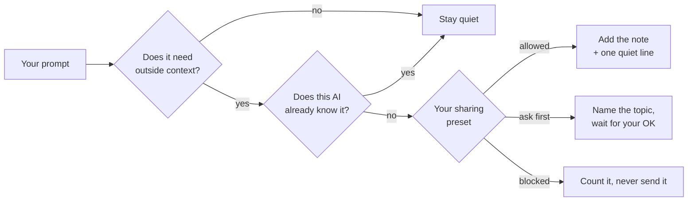

<div align="center">

# ◆ headsup

**Gives your AI a heads-up before it answers.**

Shared memory across ChatGPT, Claude and your coding agents. It steps in only when a question is missing context, and only with what you allow.


</div>

---

You use ChatGPT for writing and Claude Code for building. Then one day you ask Claude Code for release notes "in my voice", and it has no idea what your voice is. ChatGPT knows, but that knowledge is stuck in ChatGPT.

headsup notices that gap, finds the right note from your other tool, and passes it along before the answer is written. Most of the time it does nothing at all.

```text
~/work/northwind-api — claude
> write the v2.3 release notes in my voice

◆ heads-up · added 1 note from ChatGPT · personal (how you work)

● ## v2.3
  Billing webhooks are faster. Retries no longer double-charge.
  Checkout errors now show a clear message instead of a stack trace.
```

<!-- TODO before launch: replace the block above with the demo GIF (ChatGPT cover letter, notes ticked before sending). -->

## Why

- **Your memory is split by vendor.** ChatGPT, Claude and Gemini each keep their own memory. None of them has a reason to share it.
- **Importing once isn't enough.** Claude and Gemini can now import another assistant's memory, but that's a one-time move into a new silo. You keep using several tools, and your context keeps drifting apart.
- **Storing isn't the hard part. Knowing when to speak up is.** Most memory tools save everything and wait for the AI to go looking. headsup reads the question first and only steps in when *this* tool is missing something *another* tool knows.

## How it works



1. **Does it need context?** Unresolved references like "my usual setup", "that project", "like last time", a question outside what you normally use this tool for, or a strong match with a note from another tool.
2. **Does this AI already know?** Notes that are already in `CLAUDE.md`, `AGENTS.md`, the current conversation, or came from this same tool and project are left out.
3. **May it cross over?** Notes live in a **work** or **personal** space. Your preset decides what may travel between them (below).
4. **Show what happened.** Every heads-up prints one line saying what was added and where it came from. `headsup review` shows the rest.

Notes are collected for you: when a Claude Code session ends or goes quiet, and when you open chatgpt.com or claude.ai with the extension installed. Chats you had in the phone and desktop apps sync through your account, so they come in too. In the background, notes that say the same thing are merged, and ones a newer fact replaced are set aside.

## Share how you work, not what you work on

Every note is either **how you work** (preferences, style, conventions) or a **fact** (people, companies, projects). Secrets are scrubbed before anything is written to disk.

| Preset | How you work | Facts | Secrets |
|---|---|---|---|
| Cautious | ask first | blocked | never stored |
| **Balanced** (default) | automatic | ask first | never stored |
| Open | automatic | automatic | never stored |

"Ask first" means headsup names the topic, not the content. In a terminal the agent asks you in the conversation, and nothing is sent until you say yes. In the browser, related notes appear pre-ticked and you untick the ones that should stay home:

```text
◆ heads-up · 1 work note waiting for your OK (ci)
◆ heads-up · 2 work notes stayed home (repo names, runner config) · preset: Cautious
```

## Where it works

| Where you use AI | How headsup connects | What you get |
|---|---|---|
| **Claude Code** | hooks | Checked on every prompt, notes added before the answer |
| **chatgpt.com · claude.ai** | Chrome extension | Notes attached as you hit send. Untick any first |
| **ChatGPT · Claude apps** (phone, desktop) | your account, through the extension | App chats are collected, and an "About me" block in your custom instructions is kept up to date (opt-in). No per-question notes |
| Codex CLI · Gemini CLI | hooks | Coming soon |
| Cursor · Claude Desktop · Windsurf | MCP | After launch. The AI decides when to call it, so it can miss |
| Phone only, no desktop Chrome | — | Not supported |

## Quick start

> **Pre-release.** headsup isn't on npm or the Chrome Web Store yet. Once it is, setup is one line: `npx headsup-ai setup`. Until then, run it from source.

You need Node 22+, pnpm and [Claude Code](https://claude.com/claude-code). headsup summarizes chats through your own `claude` login, so there's no API key to paste.

```sh
git clone https://github.com/brianlee0113/headsup.git
cd headsup
pnpm install && pnpm build && npm link   # puts `headsup` on your PATH
headsup setup
```

`headsup setup` takes about a minute and asks five things:

1. **Agents.** Connect Claude Code. It adds its own hook entries to `~/.claude/settings.json` and backs up the file first.
2. **How you split your tools**, in your own words. For example: *"Claude for coding and side projects, ChatGPT for writing and everyday stuff."*
3. **Which folders are work.** Everything else is personal.
4. **Sharing preset.** Balanced unless you change it.
5. **Bring existing memory** (optional). Import your ChatGPT data export once. After that, the extension keeps up on its own.

**Chrome extension (chatgpt.com, claude.ai):**

```sh
pnpm build:ext
headsup connect-browser
```

Then open `chrome://extensions`, turn on Developer mode, choose **Load unpacked**, and pick `extension/build`. It also works in Chrome Beta, Chromium, Brave, Edge and Arc.

## Your data

- **Notes stay on your computer**, in `~/.headsup/notes/` as plain Markdown files. You can read, edit or delete them by hand.
- **Summaries use your own Claude login.** Turning a session or chat into notes runs `claude -p` with the haiku model on your account. headsup has no server, no account and no telemetry.
- **Health, relationships, money, legal matters, religion and politics** are skipped when ChatGPT history is imported. Secrets such as API keys and tokens are dropped before anything is written.
- **The extension only reads your own chats, on sites you have open, while you're signed in.** It only writes inside its own fenced block in your custom instructions, and only if you turn "About me" on. Turning it off removes the block.
- **Uninstall** with `headsup uninstall`. It removes the hook and the browser connection and keeps your notes.

## Commands

```text
headsup setup              connect Claude Code and choose what may be shared
headsup review             see what was shared where; edit, reclassify or delete notes
headsup connect-browser    let the Chrome extension reach headsup on this computer
headsup import chatgpt <export.zip>
                           turn your ChatGPT history into notes (last 12 months)
headsup card               make a shareable card: which AI you use for what
headsup add | list | search | log
headsup uninstall          remove the hook and browser connection (your notes stay)
```

Most of the work happens without a command. Capturing sessions, catching up on sessions that never ended (tmux panes, reboots), syncing chats from your accounts and tidying notes all run in the background.

## FAQ

**Isn't this just another memory MCP server?**
No. An MCP server waits for the model to decide to call it, and models often don't. headsup sits *before* the model. It reads your prompt, decides whether outside context is missing, and adds only that. Coding agents get it through hooks and web chats through the extension. MCP is planned only for tools that have no hook to use.

**Won't it stuff every prompt with notes?**
That's the failure it's built to avoid. A note is left out if this AI already has it in its context files or in the conversation. Weak matches are dropped too. The card made by `headsup card` shows how many of your prompts it actually stepped in on.

**What stops work information leaking into my personal AI?**
Spaces and presets. Facts that would cross from work to personal are held back until you approve them, or blocked entirely under Cautious. Notes can also be marked never-share.

**Does it use the ChatGPT or Claude APIs?**
The extension uses the same internal endpoints the sites use, from your own signed-in session. They can change without notice. When one does, the extension tells you in its popup instead of failing silently.

## Development

```sh
pnpm test                         # unit tests (vitest)
pnpm typecheck
pnpm tsx test/eval.ts             # retrieval eval set: recall / precision on English and Korean prompts
node scripts/e2e-extension/run.mjs   # extension end to end: Chrome for Testing + real native host + mock chatgpt.com
```

The code is TypeScript with no runtime dependencies. Search is BM25 plus a small concept dictionary (`src/concepts.ts`), so "cover letter" finds notes about your internship without an embedding model.

## Roadmap

- [x] Claude Code: add notes before each prompt, capture sessions when they end
- [x] Chrome extension for chatgpt.com and claude.ai
- [x] Account sync for app chats, "About me" block
- [x] Review TUI, ChatGPT import, background tidy, share card
- [ ] Tune when to step in, using simulated conversations
- [ ] npm and Chrome Web Store release
- [ ] Codex CLI and Gemini CLI hooks
- [ ] gemini.google.com
- [ ] Thin MCP server for Cursor, Claude Desktop and Windsurf

## License

[MIT](LICENSE). Bundled fonts (Geist, JetBrains Mono) are under the SIL Open Font License. See `assets/fonts/`.
